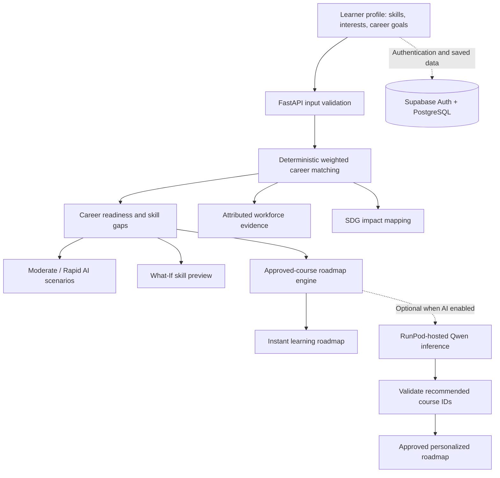

<div align="center">

# 🌐 SkillShift AI

**Understand your skills. Explore future careers. Learn what comes next.**

An explainable, Malaysia-focused career-readiness and reskilling platform developed for the **SDC Hackathon 2026 — Domain 1: Aiversecity Future-Ready Workforce**.

**Primary SDG:** SDG 4 — Quality Education (Target 4.4)  
**Supporting SDG:** SDG 8 — Decent Work and Economic Growth

**Live application:** _Add the verified public Replit deployment URL_  
**Source code:** _Add the public GitHub repository URL_  
**Video demonstration:** _Add a link when the video is published_

</div>

## The problem

AI is changing workplace tasks and skill requirements, but Malaysian students and fresh graduates can struggle to determine **which skills they already have, how closely they match a career, and what they should learn next**. Generic advice may not explain its scoring, evidence, or uncertainty.

**SkillShift AI turns a learner's skill profile into an explainable career-readiness assessment and an actionable reskilling roadmap**, supported by attributable workforce observations where suitable data is available.

## What SkillShift AI does

| Feature | What users get |
| --- | --- |
| **Skills profile** | Enter existing skills, interests, educational context, and a career of interest. |
| **Explainable career matching** | Explore **nine curated careers** using deterministic weighted readiness scores, matched competencies, and skill gaps. |
| **Future scenarios** | Compare hypothetical **Moderate** and **Rapid** AI-adoption assumptions without treating them as employment forecasts. |
| **Career Readiness What-If Simulator** | Preview how adding a missing skill could change a readiness score **without modifying the original profile**. |
| **Workforce evidence** | Review source-labelled and dated occupational observations where supported by the curated evidence catalog. |
| **Instant learning roadmap** | Generate an ordered learning plan from **39 curated, approved learning resources**, including study-time estimates where available. |
| **Optional AI personalization** | When enabled, use RunPod-hosted Qwen inference to select or reorder **approved courses only**, subject to backend validation. |
| **Supabase accounts** | Authenticate and use supported account-linked profile, analysis, and roadmap storage features. |
| **SDG impact mapping** | Explore how relevant skills and learning pathways connect to **SDG 4, Target 4.4**, with supporting relevance to SDG 8. |

### How it works



**Why the distinction matters:** Career-readiness scores are calculated by a transparent, rule-based **weighted skill-matching engine**, not generated by a language model. Optional generative AI can help personalize the learning plan, but the backend restricts its output to approved course identifiers. The standard roadmap does **not** require RunPod.

## Try the demo

### Reproducible fictional learner scenario

| Item | Example |
| --- | --- |
| Persona | Fictional Malaysian IT undergraduate |
| Existing skills | Python, SQL |
| Career of interest | Data Analyst |
| Initial scenario | Moderate AI adoption |
| What-If skill | Power BI, if present in the current skills catalog |

1. Open the **live SkillShift AI application** using the verified Replit link above, or run it locally.
2. Create a fictional learner profile and select **Python** and **SQL** as existing skills.
3. Choose **Data Analyst** as the career of interest, then run the career analysis.
4. Review the readiness score, matched competencies, and missing skills.
5. Open the **What-If Simulator** and preview the possible change from learning **Power BI** (if available in the catalog). Check that the original profile is unchanged.
6. Compare the **Moderate** and **Rapid** AI-adoption scenarios.
7. Generate the **instant approved-course learning roadmap** and review its learning resources and estimated study times.
8. Open the **Workforce Evidence** and **SDG Impact** sections to inspect supporting sources and the connection to SDG 4.4.
9. Optionally sign in and try AI roadmap personalization **only if the public deployment has it enabled**.

> **Demo interpretation:** This profile is fictional. Scores depend on the current catalog and skill weights and are **not** probabilities of employment. The What-If result is a hypothetical skill-match comparison, not a promise that a course or certificate guarantees a job. No specific score is claimed here because the latest deployed values have not been independently verified.

## Technical stack

| Layer | Technologies and responsibilities |
| --- | --- |
| **Frontend** | React 19, TypeScript, Vite, Recharts, and the UI libraries installed in the frontend project |
| **Backend** | Python 3.12, FastAPI, Pydantic, Uvicorn, and deterministic analysis modules |
| **Authentication and storage** | Supabase Authentication and PostgreSQL, with user-owned records protected through configured access policies |
| **Optional generative AI** | Qwen language model hosted on RunPod; server-side course-ID validation and operational limits |
| **Data** | Curated career, skill, learning-resource, scenario, and workforce-evidence catalogs |
| **Deployment** | **Deployed on Replit**; FastAPI serves the compiled React app and API under one public HTTPS deployment |
| **Source control** | Git and GitHub |

> **Version accuracy:** The project's current Replit configuration has been described as using **Node.js 20**. Confirm the committed `.replit` file and current frontend dependencies before declaring a different Node.js version. Do not list Tailwind CSS unless the installed frontend actually uses it. The exact Qwen checkpoint and public RunPod availability also require confirmation from the AI integration owner.

## Run locally

**Prerequisites:** Python 3.12, npm, and a compatible Node.js version (use **Node.js 20** if matching the currently documented Replit setup). The commands below are for **Windows PowerShell**, from the repository root.

### 1. Start the FastAPI backend

```powershell
python -m venv .venv
.\.venv\Scripts\python.exe -m pip install -r requirements.txt
Copy-Item .env.example .env
.\.venv\Scripts\python.exe -m uvicorn backend.main:app --reload --port 8000
```

The backend API is available at `http://localhost:8000`. Configure any required values in the untracked `.env` file using [`.env.example`](.env.example) as a reference.

### 2. Start the React frontend

Open a second PowerShell terminal in the repository root:

```powershell
cd frontend
npm ci
npm run dev
```

Open **http://localhost:5173** in your browser.

For Supabase authentication, configure the **public** client environment variables documented in [`frontend/.env.example`](frontend/.env.example). For optional AI inference, configure the **backend-only** RunPod credentials and `AI_ENABLED=true` as described in [`.env.example`](.env.example). The core matching, scenario, What-If, and instant roadmap features do **not** depend on RunPod.

**Never commit** `.env` files, API keys, service-role credentials, virtual environments, or other secrets.

## Replit deployment

SkillShift AI is **deployed through Replit**. Its deployment builds the React frontend, installs backend dependencies in an isolated Python environment, and starts FastAPI using Uvicorn. The compiled UI and backend API are served from a **single public HTTPS address**.

- **Production build and startup:** Follow the committed [`.replit`](.replit) configuration and repository scripts; do not rely on obsolete deployment commands.
- **Private configuration:** Keep credentials in **Replit Secrets** / server-side environment settings, not frontend source code.
- **Public frontend configuration:** Supply only intended public Vite variables during the frontend build.
- **RunPod independence:** The normal approved-course roadmap should remain available even when GPU inference is disabled or unreachable.
- **Deployment verification:** Check the published site, its API routes, sign-in, and the full demo journey using the actual HTTPS URL.

> **Public AI status:** RunPod personalization is optional. It can be disabled (for example, with `AI_ENABLED=false`) or unavailable because of latency, timeouts, or quotas. Do not interpret the presence of integration code as proof that the public deployment currently provides working GPU inference.

## Testing and verification

Automated backend tests cover application logic, API behavior, security-related controls, and integration-oriented functionality.

**Latest reported local verification: 165 Python tests passed on 24 October 2026.** This is a **local test result**, not a claim that the same suite passed on the live Replit runtime.

Run the backend tests from the repository root:

```powershell
python -m pytest -q
```

Verify the production frontend build:

```powershell
cd frontend
npm ci
npm run build
```

Passing automated tests helps verify expected behavior, but does not by itself prove full security, live-service reliability, or labor-market forecasting accuracy. The published Replit deployment requires separate end-to-end verification.

## Data sources and evidence

SkillShift AI separates **three different kinds of inputs**:

| Type | Interpretation |
| --- | --- |
| **Source-attributed workforce observations** | Dated contextual labor-market evidence. Coverage and comparability may differ by occupation. |
| **Curated career, skill, and course metadata** | Team-maintained matching and learning-resource inputs; course links remain subject to their providers' terms. |
| **Hypothetical AI-adoption multipliers** | Team-defined scenario assumptions for exploration, **not** measured future employment outcomes. |

Workforce information may draw on sources such as the **Department of Statistics Malaysia (DOSM)** and other documented references **only where they are actually represented in the curated catalog**. A source's appearance in documentation is not evidence that every statistic or dataset has been incorporated.

For exact references, dates, source links, and any applicable reuse conditions, see [Data sources](docs/data_sources.md). Learning resources link to their original providers; inclusion does not imply endorsement or transfer of third-party rights.

## SDG alignment

SkillShift AI primarily supports **United Nations Sustainable Development Goal 4 — Quality Education**, especially **Target 4.4**, which concerns increasing the number of youth and adults with relevant skills for employment, decent jobs, and entrepreneurship. The platform has supporting relevance to **SDG 8 — Decent Work and Economic Growth**.

The **SDG Impact** view explains how identified gaps and suggested learning pathways relate to those goals. This is an **educational alignment**, not proof that using the application causes better employment outcomes.

For later prototype evaluation, the proposed **Actionable Pathway Completion Rate** is the percentage of predefined fictional user scenarios producing all three of the following: an explainable career match, at least one relevant approved learning resource, and a visible SDG connection.

**Proposed Phase 2 target:** at least **90% across 10 predefined fictional learner scenarios**. This is a **future evaluation target**, not an achieved result.

## Reliability, privacy, and responsible AI

- **Explainability:** Readiness is a deterministic weighted skill-overlap score, not a hiring likelihood.
- **Bounded AI output:** Optional generative AI may only recommend approved course identifiers after backend validation.
- **Graceful degradation:** Instant deterministic roadmap generation works independently of optional AI personalization.
- **Source awareness:** Occupational observations are not automatically skill-level demand measurements; evidence may be absent or incomplete.
- **Scenario honesty:** Moderate and Rapid assumptions are illustrative, not validated employment forecasts.
- **Account data:** Supabase may process real authentication email addresses and account-linked information even though public examples use fictional learner profiles.
- **Access controls:** Backend input validation, authenticated operations, and configured database access policies help protect user-associated records.
- **Secret management:** Sensitive credentials belong in server-side environment settings, not the public repository or browser bundle.
- **Data minimization:** Optional inference requests should avoid unnecessary personal identifiers.

The project is a hackathon MVP, **not** a certified security assessment, hiring tool, or professional career-advice service.

## Current MVP limitations

- The matching engine covers a **bounded set of curated careers and skills**, not all Malaysian occupations.
- Workforce observations are not available or directly comparable for every supported career.
- Curated skill weights and AI-adoption scenario multipliers are modelling choices, not independently validated employment predictions.
- Readiness percentages measure **weighted skill compatibility**, not the probability of getting hired.
- Some missing skills may not have a suitable approved learning resource in the current catalog.
- Optional RunPod inference can be affected by model availability, cold starts, latency, authentication, configuration, and usage quotas.
- The prototype does not provide validated real-time labor-market forecasts or make hiring decisions.
- A full independent production security, privacy, and accessibility audit has not been established.

## Team

| Member | Responsibility |
| --- | --- |
| **Member 1** | Frontend, interaction design, and user experience |
| **Member 2** | FastAPI backend, career matching, API integration, testing, security, and Replit deployment |
| **Member 3** | RunPod inference and optional AI-assisted learning-roadmap personalization |
| **Member 4** | Malaysian workforce evidence, career/skill catalog, and approved learning resources |

_Replace member labels with the team's approved registered names and GitHub profiles if the team wishes to publish them._

## Project documentation

- [System architecture](docs/architecture.md) · [Backend](docs/backend.md) · [Frontend](docs/frontend.md)
- [AI integration](docs/ai_integration.md) · [Data sources and references](docs/data_sources.md)
- [Security and deployment notes](docs/SECURITY_HARDENING_2026.md) · [AI and tools declaration](docs/ai_tools_declaration.md)

## License

The **team-owned SkillShift AI source code** is released under the **Apache License, Version 2.0**. See [`LICENSE`](LICENSE) for the full license text.

Third-party libraries, pretrained models, datasets, course materials, artwork, and other externally sourced content remain subject to **their own licenses and terms**. Their inclusion or reference here does not transfer ownership or relicense them under Apache-2.0.

---

<div align="center">

**SkillShift AI** · **SDG 4 — Quality Education** · *Learning pathways, not employment guarantees.*

</div>
