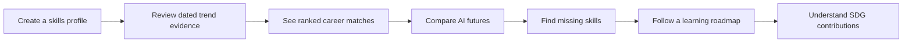
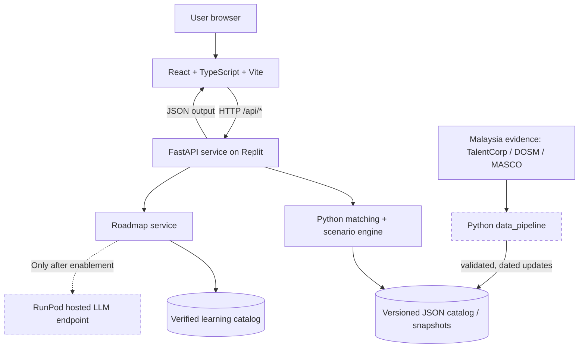
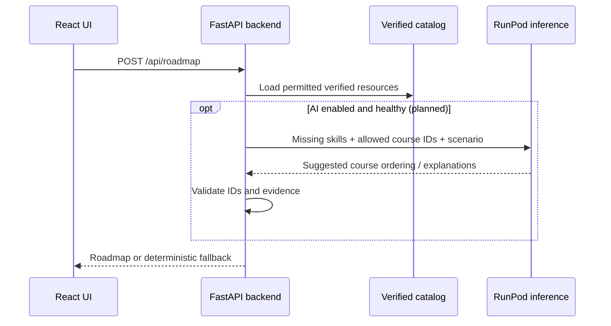
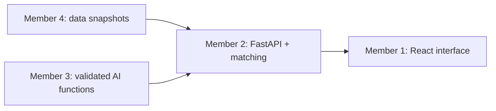

<div align="center">

# 🌐 SkillShift AI

### Future Skills Intelligence · Explainable Career Matching · Adaptive Learning

**Understand tomorrow's skills. Build your future today.**

A Malaysia-focused, evidence-informed career-readiness and reskilling platform built for the  
**SDC Hackathon — Domain 1: Aiversecity Future-Ready Workforce**.

<p>
  
  
  
</p>

<p>
  
  
  
  
  
  
</p>

**[Overview](#overview)** · **[Features](#features--official-requirements)** · **[Architecture](#system-architecture)** · **[Setup](#getting-started-local-development)** · **[API](#api-reference)** · **[Team](#team-structure--module-ownership)** · **[Roadmap](#seven-day-hackathon-plan)**

</div>

> [!IMPORTANT]
> **Current implementation:** SkillShift AI has a catalog-backed, instant `/api/roadmap` and an *optional*, authenticated `/api/roadmap/personalize` backed by RunPod when `AI_ENABLED=true`. The curated Malaysian career/course catalog and DOSM evidence are included; not every career has observed market data or approved courses for every skill. AI output is revalidated against the catalog. Production readiness depends on the security and deployment checks in **[Security Hardening](docs/SECURITY_HARDENING_2026.md)**; a green unit-test run is not a production penetration test.

---

## Table of contents

1. [Overview](#overview)
2. [Problem statement and proposed solution](#problem-statement--proposed-solution)
3. [SDG alignment](#sdg-alignment)
4. [Features and official requirements](#features--official-requirements)
5. [Current implementation status](#current-implementation-status)
6. [Product walkthrough](#product-walkthrough)
7. [System architecture](#system-architecture)
8. [Technology stack](#technology-stack)
9. [Project directory structure](#project-directory-structure)
10. [Getting started: local development](#getting-started-local-development)
11. [RunPod AI integration](#runpod-ai-integration)
12. [Malaysian datasets and evidence](#malaysian-datasets--evidence)
13. [Career-matching and scenario methodology](#career-matching--scenario-methodology)
14. [API reference](#api-reference)
15. [Replit deployment](#replit-deployment)
16. [Testing and quality assurance](#testing--quality-assurance)
17. [Team structure and module ownership](#team-structure--module-ownership)
18. [GitHub workflow](#github-workflow--contribution-guidelines)
19. [Seven-day hackathon plan](#seven-day-hackathon-plan)
20. [Demonstration and evaluation](#demonstration--evaluation)
21. [Responsible AI, privacy and limitations](#responsible-ai-privacy--limitations)
22. [Troubleshooting](#troubleshooting)
23. [Documentation, credits and license](#documentation-credits--license)

---

## Overview

**SkillShift AI** combines two complementary concepts into a single learning-oriented workforce platform:

| Component | Question it answers | Proposed value |
| --- | --- | --- |
| **SkillPulse** — Future Skills Radar | *Which AI-related skills appear important in recent, dated workforce evidence?* | Makes changing skill signals visible and traceable to sources. |
| **FutureShift** — Scenario Simulator | *How might my readiness change under different, explicitly hypothetical AI-adoption scenarios?* | Helps users compare possible outcomes rather than treating one forecast as certain. |
| **SkillShift** — Personalized Reskilling | *What should I learn next, and where can I learn it affordably?* | Converts a skills gap into a time-estimated, explainable learning pathway. |

### Primary audience

**Malaysian university students and fresh graduates**, with a possible later extension to career switchers, existing workers, career centers and HR teams.

### The core user journey



### Project goals

- Connect workforce evidence to career recommendations instead of relying on an unconstrained chatbot response.
- Offer an **explainable skills-readiness score** and a clear list of strengths and missing skills.
- Show how **moderate** and **rapid** AI adoption assumptions change skill priorities.
- Support **SDG 4 — Quality Education**, especially access to practical and relevant learning opportunities.
- Use **Malaysia-specific evidence wherever available**, while clearly labeling foreign, historical, synthetic or hypothetical inputs.
- Deliver a functional, reviewable hackathon demonstration with traceable implementation choices.

### What this is not

SkillShift AI is **not** an automated hiring decision system, a guaranteed job prediction, a validated measure of employment probability, or a replacement for a trained career counselor.

---

## Problem statement & proposed solution

### The challenge

Rapid AI adoption is changing tasks, tools and skill expectations. Students entering the labor market often face three connected questions:

1. Which skills are currently relevant to the career paths they are considering?
2. How might those skill requirements change as AI adoption changes?
3. Which affordable learning opportunities can address the gaps between their current profile and target role?

A static occupation list or general-purpose AI chatbot may answer parts of these questions, but it does not by itself demonstrate **dated trend evidence, changeable recommendations, explainability, uncertainty handling, and accessible reskilling**.

### Our proposed response

SkillShift AI brings together:

**Source-backed labor evidence** → **normalized occupation/skill catalog** → **transparent role matching** → **scenario comparison** → **verified learning resources and SDG explanations**.

The platform's intended differentiator is **traceability**: a reviewer should be able to inspect which skill, weight, trend snapshot, and future scenario contributed to a result.

### Preliminary-round judging alignment

The Domain 1 brief's preliminary-round scoring categories are:

| Criterion | Weight | Our approach |
| --- | ---: | --- |
| Innovation & Creativity | **30%** | Combine source-backed trend signals with an interactive uncertainty simulator and learning-to-readiness feedback. |
| Problem–Solution Fit | **25%** | Design around all six Domain 1 must-haves and a defined Malaysian student user group. |
| Feasibility of Build | **25%** | Small curated dataset, deterministic matching, modular Python services, Replit target, RunPod integration with fallback. |
| Clarity of Proposal | **20%** | Present an understandable problem, evidence-to-recommendation process, known limitations and measurable demo. |

These are **competition criteria, not predicted scores**; the team must still implement and demonstrate the claimed behavior.

---

## SDG alignment

### Primary: SDG 4 — Quality Education

SkillShift AI is designed around **relevant, accessible, personalized upskilling**, not just job suggestions.

| SDG target | How SkillShift intends to contribute | What the demo can show |
| --- | --- | --- |
| **4.3 — Access to technical, vocational and tertiary education** | Surface verified free or low-cost learning opportunities. | Resource links, cost labels, and learning time. |
| **4.4 — Skills for employment and entrepreneurship** | Identify role-specific gaps and organize the next skills to learn. | Skill-gap explanation and sequenced learning pathway. |

### Supporting goals

| SDG | Relation to the project | Important limitation |
| --- | --- | --- |
| **SDG 8 — Decent Work and Economic Growth** | Helps users prepare for changing job skill requirements. | Improved employment outcomes have **not** been measured. |
| **SDG 9 — Industry, Innovation and Infrastructure** | Highlights skills related to technological capability and resilient digital systems. | Mapping must be justified for each actual skill/role. |
| **SDG 5 — Gender Equality** | Future fairness and inclusive-access review. | Not a demonstrated outcome in the scaffold. |
| **SDG 10 — Reduced Inequalities** | Accessible, low-cost learning and a potential multilingual interface. | Requires actual accessibility and equity assessment. |

> [!NOTE]
> The initial `data/sdg_mapping.json` contains **illustrative rationales**. A production-quality implementation should map each supported role and skill to applicable SDGs with a documented reason; it must not infer measured SDG impact from a label.

---

## Features & official requirements

The intended application covers **all six** Domain 1 must-have areas. The status column is intentionally conservative.

| Official requirement | Planned behavior | Current state |
| --- | --- | --- |
| **1. Skills Profile Intake** | Collect education/background, selected skills and career interests. | **Working starter:** form with selectable sample skills. |
| **2. AI-Trend Signal Layer** | Update dated workforce evidence and display sources, period, geography and retrieval date. | **Partial:** displays synthetic trend fixture; real import/refresh not finished. |
| **3. Future-Role Matching + Skills Gap** | Calculate ranked role readiness, matched skills, missing skills and scoring breakdown. | **Working starter:** deterministic matching with synthetic catalog. |
| **4. Personalized Reskilling Pathway** | Return ordered, time-estimated steps linking to verified free/low-cost learning resources. | **Partial:** deterministic fallback; current sample courses are unverified and are filtered out. |
| **5. SDG Mapping** | Explain relevance of each supported role and skill to SDGs, with SDG 4 central. | **Partial:** starter SDG explanations; fine-grained evidence-based mapping pending. |
| **6. Handling Uncertainty** | Compare at least two AI-disruption scenarios and show recalculated readiness. | **Working starter:** moderate/rapid hypothetical scenario calculations. |

### Proposed extensions (not required for the first MVP)

- Learning progress and **what-if skill acquisition** simulation.
- Malay / English / Chinese language support.
- A career-center or employer aggregate view (using appropriate synthetic or consented data).
- Accessibility and fairness checks across relevant user groups.
- Automated scheduled updates **after** a reliable manual import pipeline works.

**Scope decision:** do **not** prioritize authentication, payment processing, scraping restricted job sites, custom LLM training, or an elaborate database during the first week.

---

## Current implementation status

This section records what is actually present in the starter repository, rather than the full envisioned product.

| Capability | What is present now | Next engineering step |
| --- | --- | --- |
| React multi-page interface | Profile, Trends, Careers, Simulator, Roadmap, SDG Impact views | UI polish, accessibility, verified evidence display |
| FastAPI service | Health, catalog, trends, analysis, scenarios, roadmap and SDGs endpoints | Contract hardening, source traceability and refresh endpoint |
| Skills matching | Weighted overlap, missing skills and ranked results | Replace synthetic inputs and justify weights |
| Scenario comparison | Two team-defined multiplier sets | Publish rationale and sensitivity tests |
| Skills extraction | Conservative explicit-phrase Python baseline | Add grounded RunPod-assisted extraction with validation |
| RunPod connection | OpenAI-compatible client helper in `ai/runpod_client.py` | Confirm endpoint, configure secrets, invoke in validated production flow |
| Learning roadmap | Deterministic fallback from verified resource catalog | Verify courses and add bounded AI explanation |
| Malaysian data | OpenDOSM fetch helper and source-design notes | Build real dated evidence snapshots and provenance validation |
| Trend refresh | Placeholder function raises `NotImplementedError` | Implement source import, validation and snapshot updates |
| Automated checks | Python tests and GitHub Actions configurations | Run CI on pushes; confirm frontend build on development machine |
| Replit deployment | `.replit` configuration and startup script | Import, build frontend and publish live deployment |

**No public deployment URL or completed RunPod inference is claimed by this README.** Add those details only after real deployment and integration.

---

## Product walkthrough

The following example is **synthetic** and used only to explain functionality.

**Example profile**

```json
{
  "education": "IT undergraduate (synthetic)",
  "skills": ["skill_python", "skill_sql"],
  "interests": ["data"]
}
```

1. **Profile:** a student selects the skills they already possess.
2. **Trend overview:** the dashboard displays a labeled evidence snapshot; the starter shows synthetic weights, not Malaysian market measurements.
3. **Matching:** the backend ranks available occupations using required skills, skill importance and trend/scenario multipliers.
4. **Skills gap:** the response shows which required skills are present or absent, alongside their effective weights.
5. **Scenario simulator:** the app compares moderate versus rapid adoption assumptions; calculations are repeated for the same profile.
6. **Learning pathway:** the user receives only **verified** course records covering missing skills; currently no starter resource is verified, so the roadmap correctly reports coverage gaps.
7. **SDG context:** the interface explains intended SDG 4 / 8 / 9 relevance without claiming actual social impact.

### Suggested live-demo story after completion

- Display a dated, attributable **Malaysian** evidence snapshot.
- Refresh/import a second comparable snapshot and demonstrate a **real calculation changing**.
- Analyze a synthetic student profile; inspect ranked career readiness and missing skills.
- Switch between moderate and rapid scenarios and compare results.
- Request a RunPod-assisted explanation grounded in the verified resource catalog.
- Show the learning pathway, estimated time, course links and SDG 4 contribution.

If a change is demonstrated using deliberately fabricated test signals, identify it as a **synthetic mechanism test**—not a real labor-market trend.

---

## System architecture

### End-to-end application flow



**Current versus proposed architecture:** the frontend and FastAPI endpoint chain exist; source refresh and RunPod-mediated roadmap generation are **not yet active end to end**.

### Separation of responsibilities

| Component | Owns | Must not do |
| --- | --- | --- |
| **Frontend** | Form controls, charts, comparisons, input feedback, responsive UI. | Store API secrets or create authoritative match scores. |
| **Backend** | Request validation, deterministic matching, scenario calculations, public API routes. | Assume LLM-generated numbers are verified market statistics. |
| **AI layer** | Evidence-bounded extraction and learning explanations, validation and fallback. | Invent courses, sources, role demand or employment probabilities. |
| **Data pipeline** | Verified datasets, source IDs, skill normalization, publication dates, snapshot generation. | Pass synthetic fixtures off as observed Malaysian signals. |

### Why both Replit and RunPod?

- **Replit:** intended deployment environment for the web app and FastAPI backend.
- **RunPod:** intended GPU-backed hosted language-model inference for evidence-grounded skill extraction and personalized learning explanation.
- **Python matching engine:** retains control of numeric scoring; scores are **not** invented by the LLM.

This division keeps the system explainable and allows a useful fallback if AI inference is temporarily unavailable.

---

## Technology stack

The table below reflects dependencies in this repository and intended external services.

| Layer | Tool / technology | Used for | Integration state |
| --- | --- | --- | --- |
| Editor | **Visual Studio Code** | Local team development | Local prerequisite |
| Version control | **Git + GitHub** | Branching, PRs, history, CI | Repository configuration included |
| Frontend | **React 19 + TypeScript 5 + Vite 7** | Application shell and interactive pages | Starter code included |
| Styling | **Tailwind CSS 4** | Styling and responsive UI | Tooling included; UI refinement ongoing |
| Charts and icons | **Recharts + Lucide React** | Visualizations and icons | Dependencies included; further chart UI planned |
| Backend | **Python 3.12 + FastAPI + Uvicorn** | REST API and orchestration | Starter endpoints included |
| Validation | **Pydantic 2** | Typed backend contracts | Basic request schemas included |
| Data handling | **JSON + Pandas + HTTPX** | Lightweight catalogs and CSV retrieval | Fixtures and fetch helper included |
| AI runtime | **RunPod hosted inference** | LLM requests | Client helper exists; integration pending |
| AI client | **OpenAI Python SDK** | Chat Completions against compatible endpoint | Helper included |
| Tests | **Pytest** | Python unit/API tests | Included and runnable |
| CI | **GitHub Actions** | Python tests and frontend build | Workflow files included |
| Hosting | **Replit** | Single hosted full-stack app | Configuration included; deployment pending |

> [!TIP]
> Keep the initial implementation to **one repository and one published web service**. Build React with Vite, then serve `frontend/dist` from FastAPI. You do not need Docker or a separate frontend host for the MVP.

---

## Project directory structure

```text
skillshift-ai/
├── frontend/                     # Member 1 — React interface
│   ├── src/
│   │   ├── api/client.ts          # Typed fetch wrapper for /api
│   │   ├── components/Layout.tsx  # Shared navigation/layout
│   │   ├── pages/
│   │   │   ├── ProfilePage.tsx
│   │   │   ├── TrendsPage.tsx
│   │   │   ├── CareersPage.tsx
│   │   │   ├── SimulatorPage.tsx
│   │   │   ├── RoadmapPage.tsx
│   │   │   └── SDGPage.tsx
│   │   ├── types.ts
│   │   ├── App.tsx
│   │   ├── main.tsx
│   │   └── index.css
│   ├── package.json
│   ├── vite.config.ts
│   └── tsconfig.json
│
├── backend/                      # Member 2 — APIs and scoring
│   ├── routes/
│   │   ├── analysis.py
│   │   ├── catalog.py
│   │   ├── roadmap.py
│   │   └── trends.py
│   ├── main.py
│   ├── schemas.py
│   ├── matching.py
│   ├── scenarios.py
│   └── store.py
│
├── ai/                           # Member 3 — RunPod + learning
│   ├── runpod_client.py          # Hosted LLM client helper
│   ├── skill_extractor.py        # Explicit-phrase starter extractor
│   ├── learning_planner.py       # Verified-course fallback
│   ├── prompts.py
│   └── validators.py
│
├── data_pipeline/                # Member 4 — Malaysian evidence
│   ├── fetch_dosm.py             # Sample OpenDOSM CSV retrieval
│   ├── import_trends.py          # Real importer TODO
│   ├── normalize_skills.py
│   ├── validate_sources.py
│   └── sdg_mapping.py
│
├── data/                         # Member 4 — Versioned fixtures
│   ├── careers.json
│   ├── skills.json
│   ├── trends.json
│   ├── sources.json
│   ├── learning_resources.json
│   ├── sdg_mapping.json
│   └── synthetic_profiles.json
│
├── contracts/
│   └── api_examples.json         # Team-reviewed examples
│
├── tests/
│   ├── backend/
│   ├── ai/
│   └── data_pipeline/
│
├── docs/
│   ├── SETUP_WINDOWS_BILINGUAL.md
│   ├── architecture.md
│   ├── frontend.md
│   ├── backend.md
│   ├── ai_integration.md
│   ├── data_sources.md
│   └── ai_tools_declaration.md
│
├── scripts/
│   ├── start.sh
│   └── check.sh
│
├── .github/
│   ├── workflows/
│   │   ├── python-tests.yml
│   │   └── frontend-build.yml
│   └── pull_request_template.md
│
├── .replit
├── .env.example
├── .gitignore
├── requirements.txt
├── PROJECT_TREE.txt
└── README.md
```

**Ownership rule:** changes to another member's files or to shared contracts should be discussed and reviewed before merging.

---

## Getting started: local development

### Requirements

- **Windows 10/11, macOS or Linux**; Windows PowerShell steps are shown first.
- **Git** installed and available with `git --version`.
- **Python 3.12** (target version in GitHub Actions).
- **Node.js 22 LTS** and npm (the frontend workflow uses Node 22).
- **VS Code** or another editor.
- **RunPod credentials only if testing hosted AI**; the synthetic fallback flow does not need paid inference.

### 1. Clone the repository

If the repository has **already been created on GitHub**, use:

```powershell
git clone https://github.com/YOUR-USERNAME/skillshift-ai.git
cd skillshift-ai
code .
```

Replace `YOUR-USERNAME` with the actual account or organization name. If the repository is not yet created, extract the starter ZIP and follow [the Windows bilingual guide](docs/SETUP_WINDOWS_BILINGUAL.md) to publish it.

### 2. Create the Python virtual environment

**Windows PowerShell:**

```powershell
python -m venv .venv
.\.venv\Scripts\Activate.ps1
python -m pip install --upgrade pip
python -m pip install -r requirements.txt
```

If PowerShell blocks activation, the environment's Python can be called directly:

```powershell
.\.venv\Scripts\python.exe -m pip install -r requirements.txt
.\.venv\Scripts\python.exe -m uvicorn backend.main:app --reload --port 8000
```

**macOS / Linux:**

```bash
python3 -m venv .venv
source .venv/bin/activate
python -m pip install -r requirements.txt
```

### 3. Start the FastAPI backend

From the **repository root**, with dependencies installed:

```powershell
python -m uvicorn backend.main:app --reload --port 8000
```

Check:

- Backend health: **`http://localhost:8000/api/health`**
- Interactive API docs: **`http://localhost:8000/docs`**

Expected health response:

```json
{
  "status": "ok",
  "project": "skillshift-ai",
  "stage": "starter_scaffold"
}
```

### 4. Start the React frontend

In a **second** terminal (leave the backend running):

```powershell
cd frontend
npm install
npm run dev
```

Open **`http://localhost:5173`** in your browser.

The Vite development server proxies `/api` requests to `http://localhost:8000`, as configured in `frontend/vite.config.ts`.

### 5. Verify the application

With both terminals running:

1. Open the **Profile** page.
2. Select sample skills such as **Python** and **SQL**.
3. Click **Analyze Career Readiness**.
4. Inspect **Careers**, **Simulator**, **Trends**, **Roadmap**, and **SDG Impact**.
5. Remember that all current sample role/trend inputs are **synthetic demonstration records**.

> [!CAUTION]
> Do **not** enter real CVs, names, identification numbers, or other private personal information into this hackathon demo.

### 6. Optional environment settings

Copy the template locally:

```powershell
Copy-Item .env.example .env
```

The template includes backend-only RunPod and Supabase credentials as well as configurable
API size/rate limits and GPU quotas. RunPod's endpoint identifier is named
`RUNPOD_ENDPOINT_ID` (not `RUNPOD_BASE_URL`). Set `AI_ENABLED=false` for
the safest guest-only deployment. In development, `python-dotenv` loads `.env`;
Member 3's `ai/runpod_client.py` also explicitly calls `load_dotenv()`.

**The `AI_ENABLED` flag controls only `POST /api/roadmap/personalize`.**
`POST /api/roadmap` is deliberately deterministic and never calls RunPod.
For production host restrictions, threat-model notes and deployment examples, see
[docs/SECURITY_HARDENING_2026.md](docs/SECURITY_HARDENING_2026.md).

Never commit `.env`. Only `.env.example` belongs in Git.

---

## RunPod AI integration

### Intended purpose

The hosted language model supports two bounded tasks:

1. **Grounded skill extraction:** propose approved skill IDs from a specific excerpt and return evidence spans for review.
2. **Reskilling explanation:** organize and explain **already verified** learning resources based on missing skills and the selected scenario.

The LLM must **not** determine numerical readiness scores or fabricate sources, salaries, vacancies, course URLs or the probability of being hired.

### How Member 3 should enable it

1. Create a RunPod account and review **current pricing, access, and model availability**.
2. Select a text endpoint supporting **OpenAI-compatible Chat Completions**, or adapt the client to the endpoint's documented API format.
3. Store actual `RUNPOD_API_KEY`, `RUNPOD_BASE_URL` and `RUNPOD_MODEL` values in local environment variables or **Replit Secrets**.
4. Use `ai/runpod_client.py` to run a small server-side test request.
5. Have the planner return **structured course IDs and reasons**, not arbitrary course URLs.
6. Validate every returned skill ID, course ID, evidence reference and estimated duration.
7. Implement timeout/error handling and retain the **deterministic verified-course fallback**.
8. Only then enable the RunPod path in `backend/routes/roadmap.py` after agreement with Member 2.

### Proposed secure processing model



**Safeguard:** all RunPod requests must originate from the backend, never from browser JavaScript. Prompts and raw outputs are untrusted and must be validated.

### Current code reality

- `ai/runpod_client.py`: API helper **exists**.
- `ai/skill_extractor.py`: **local explicit-phrase baseline**, not RunPod extraction.
- `ai/learning_planner.py`: **deterministic fallback**; `use_ai=True` currently raises `NotImplementedError`.
- `backend/routes/roadmap.py`: **explicitly uses `use_ai=False`**.

Keep these facts updated as Member 3 completes integration.

---

## Malaysian datasets & evidence

The platform should prioritize authentic **Malaysian** evidence, especially for demand claims. The following are **candidate sources**, not a claim that all are already loaded into the app.

| Source | Suggested application | Data characteristics | Important caveat |
| --- | --- | --- | --- |
| [TalentCorp — Malaysia Critical Occupations List (MyCOL)](https://www.talentcorp.com.my/) | Identify occupations associated with reported labor shortages. | Periodic report / research publication | Not a real-time vacancy feed; document reporting year and interpretation. |
| [TalentCorp AI-related workforce studies](https://www.talentcorp.com.my/) | Support AI disruption themes and scenario rationale. | Research reports | Does not establish exact future probabilities. |
| [DOSM — OpenDOSM](https://open.dosm.gov.my/) | Provide Malaysian labor-market context. | Public data portal | A general wage or unemployment metric is **not** a skill demand trend. |
| [OpenDOSM data catalogue](https://open.dosm.gov.my/data-catalogue) | Discover downloadable CSV series and metadata. | Dataset catalogue | Verify update dates and geographic coverage. |
| [MASCO occupational classification](https://www.mohr.gov.my/) | Standardize Malaysia-specific occupation titles and codes. | Official classification | Does not on its own measure present or future demand. |
| [PIKOM](https://pikom.org.my/) | Context about Malaysian digital jobs and industry skills. | Reports / industry publications | Verify permissions before redistributing report extracts. |

### Example downloadable dataset

The starter's `data_pipeline/fetch_dosm.py` includes a public CSV fetch for **OpenDOSM quarterly skills-related underemployment by age**:

```text
https://storage.dosm.gov.my/labour/lfs_qtr_sru_age.csv
```

Run:

```powershell
python -m data_pipeline.fetch_dosm
```

This can help frame the **SDG 4 education-to-employment** problem. It **cannot** by itself prove that a specific technical skill is becoming more or less demanded.

### Minimum provenance for each production observation

Capture these fields for every usable trend or source record:

| Field | Why it matters |
| --- | --- |
| `source_id` and source title | Allows traceability to the original publication. |
| `url` | Allows reviewers to verify the source. |
| `published_date` / data period | Distinguishes when evidence was produced. |
| `retrieved_date` | Shows when the team last fetched it. |
| `geography` | Prevents foreign statistics being represented as Malaysian evidence. |
| `occupation_id` / `skill_id` | Links evidence to the normalized catalog. |
| `evidence_excerpt` or source page/table | Shows what supports the claim. |
| `measurement` and sample size (where relevant) | Avoids a falsely precise trend interpretation. |
| License / permitted use | Respects source restrictions and attribution obligations. |
| `evidence_status` | Separates observed, report-based, synthetic and hypothetical content. |

### Honest rules for the Trend Signal Layer

- A **single** current job-advertisement snapshot shows observed mentions, **not an upward or downward trend**.
- A growth or decline claim requires **comparable periods**, a defined population and a documented metric.
- Quarterly job-advertisement totals and salaries are supporting context, not automatically AI-skill growth indicators.
- Source-refresh functionality must update stored evidence and cause **actual recomputation**, not just change a UI label.
- Synthetic multipliers remain clearly marked until replaced by a reviewed evidence-based methodology.

### Current seed data

All initial files in `data/` are for **interface/API integration tests**. In particular:

- `data/trends.json` contains a `synthetic_demo` region and synthetic multipliers.
- `data/careers.json` contains three illustrative occupations and team-defined weights.
- `data/learning_resources.json` contains **unverified** resource placeholders, intentionally rejected by the planner.
- `data/sources.json` is a synthetic provenance fixture, not a real report citation.

**Do not describe these as validated Malaysian workforce findings in judging materials.**

---

## Career matching & scenario methodology

### Explainable readiness calculation

The backend currently computes a **weighted skill-overlap percentage** for each role:

```text
for each skill required by a role:
    effective_weight = base_role_weight
                     × trend_multiplier
                     × scenario_multiplier

readiness_score = 100 × sum(effective_weight of user-held required skills)
                        / sum(effective_weight of all required skills)
```

For skill `s`, the implementation can be summarized as:

$$
\operatorname{Readiness} = 100\,\frac{\sum_{s\in R} U_s B_s T_s A_s}{\sum_{s\in R} B_s T_s A_s}
$$

where:

- **\(R\):** required skills for the selected role.
- **\(U_s\):** 1 if the user reports possessing skill \(s\), otherwise 0.
- **\(B_s\):** role-specific base importance weight.
- **\(T_s\):** trend-derived multiplier (synthetic fixture in the current scaffold).
- **\(A_s\):** selected scenario multiplier.

The implementation resides in [`backend/matching.py`](backend/matching.py).

### Worked hypothetical example

| Required skill | Base weight | User has skill? |
| --- | ---: | :---: |
| Python | 3 | Yes |
| Networking | 3 | Yes |
| Cloud Security | 4 | No |

At neutral trend/scenario weights:

```text
readiness = (3 + 3) / (3 + 3 + 4) × 100 = 60%
```

If an *explicitly hypothetical* scenario raises the last skill's importance from 4 to 6:

```text
readiness = (3 + 3) / (3 + 3 + 6) × 100 = 50%
```

**Interpretation:** the user lacks a skill given greater priority in that scenario. **It does not mean they have a 50% probability of employment.**

### Scenario definitions

| Scenario | Meaning | Implemented behavior |
| --- | --- | --- |
| **Moderate AI adoption** | AI adoption changes workforce requirements more gradually. | Uses default/neutral scenario multipliers in the starter. |
| **Rapid AI adoption** | Some AI-related skill categories become more important under an explicitly hypothetical assumption. | Applies team-defined multipliers to selected skill IDs. |

The current values live in [`backend/scenarios.py`](backend/scenarios.py) and are **not forecasts or scientifically calibrated probabilities**. Later work should attach sources and sensitivity tests to each assumption.

### Scoring limitations

- Self-reported skill presence is binary; skill proficiency levels are not measured.
- Many role requirements are simplified for hackathon scope.
- Results can shift when the list of selected roles or the weight methodology changes.
- Readiness is **not** an employability or salary forecast.
- Economic context and course completion do not validate skill mastery.

---

## API reference

**Development base URL:** `http://localhost:8000`  
**API documentation:** `http://localhost:8000/docs`  
**Contract examples:** [`contracts/api_examples.json`](contracts/api_examples.json)

All endpoints in this table are implemented as starter routes:

| Method | Endpoint | Purpose |
| --- | --- | --- |
| `GET` | `/api/health` | Service availability and scaffold status. |
| `GET` | `/api/catalog` | Sample normalized skills and occupations. |
| `GET` | `/api/trends` | Current loaded trend snapshot (synthetic). |
| `GET` | `/api/sdgs` | SDG mapping explanations (illustrative). |
| `POST` | `/api/analyze` | Calculate ranked roles, skills gaps and score breakdown. |
| `POST` | `/api/scenarios` | Compare `moderate` and `rapid` outcomes. |
| `POST` | `/api/roadmap` | Generate verified-course fallback roadmap. |

**Not implemented yet:** a public `/api/trends/refresh` endpoint or a fully integrated RunPod-powered roadmap route.

### `POST /api/analyze`

**Request:**

```json
{
  "profile": {
    "education": "IT undergraduate",
    "skills": ["skill_python", "skill_sql"],
    "interests": ["data"]
  },
  "scenario": "moderate"
}
```

**Response example (captured from the synthetic fixture; other roles omitted):**

```json
{
  "scenario": "moderate",
  "trend_snapshot_id": "synthetic_snapshot_oct2026",
  "data_label": "SYNTHETIC TEST SIGNALS — NOT MALAYSIAN MARKET DATA",
  "scenario_disclaimer": "Hypothetical team-defined weighting, not a validated workforce prediction.",
  "matches": [
    {
      "role_id": "role_data_analyst",
      "title": "Data Analyst",
      "readiness_score": 54.2,
      "matched_skills": ["skill_python", "skill_sql"],
      "missing_skills": ["skill_power_bi", "skill_data_viz"],
      "breakdown": [
        {"skill_id": "skill_python", "matched": true, "effective_weight": 3.0},
        {"skill_id": "skill_sql", "matched": true, "effective_weight": 3.0},
        {"skill_id": "skill_power_bi", "matched": false, "effective_weight": 3.06},
        {"skill_id": "skill_data_viz", "matched": false, "effective_weight": 2.0}
      ],
      "sdgs": [4, 8]
    }
  ]
}
```

This excerpt uses **actual synthetic-fixture values** from the starter calculation but omits other ranked roles for readability. It is not Malaysian market evidence; future datasets or modified weights will change the results.

### `POST /api/scenarios`

Pass the same request body as `/api/analyze`; the server returns both computed scenarios:

```json
{
  "moderate": { "scenario": "moderate", "matches": [] },
  "rapid": { "scenario": "rapid", "matches": [] }
}
```

These are abbreviated response shapes, **not literal full responses**.

### `POST /api/roadmap`

**Request:**

```json
{
  "target_role": "role_data_analyst",
  "missing_skills": ["skill_power_bi", "skill_data_viz"],
  "scenario": "moderate"
}
```

**Current behavior:** the deterministic planner returns `steps` only when a suitable course has `verified: true` and a nonempty URL. The starter courses are unverified, so a missing-skills request typically produces `steps: []` and a list of `uncovered_skills`.

### Validation and errors

- `scenario` must be `moderate` or `rapid`.
- `/api/analyze` rejects unknown skill IDs with **HTTP 422**.
- Pydantic validates request shape before scoring.
- Downstream AI errors should not be passed raw to frontend users once RunPod is enabled.

---

## Replit deployment

Replit is the **planned deployment target**, not proof of a currently deployed public application.

### Intended single-service setup

1. Push the tested project to the shared GitHub repository.
2. Import that repository into **Replit**.
3. Install Python dependencies from `requirements.txt`.
4. Build the frontend:

   ```bash
   cd frontend
   npm install
   npm run build
   cd ..
   ```

5. Ensure environment secrets are configured in the relevant Replit environment.
6. Start the service using:

   ```bash
   bash scripts/start.sh
   ```

7. Configure the publication/start command and exposed port using the current Replit interface.
8. Check `/api/health`, `/docs`, and the frontend route in the published app.

The `.replit` file points to `scripts/start.sh`, which starts FastAPI on `0.0.0.0:${PORT:-8000}`. When `frontend/dist` exists, `backend/main.py` serves the built frontend via `StaticFiles`. **The startup script does not run `npm install` or `npm run build`; build first.**

> [!WARNING]
> Cloud deployments, AI inference, and storage can incur costs. Review current Replit and RunPod account pricing, usage limits and credits. Never assume a free tier includes unlimited running time or GPU inference.

### Deployment verification checklist

- [ ] Application boots using the deployment command.
- [ ] `/api/health` returns HTTP 200.
- [ ] Frontend pages load without console errors.
- [ ] Analysis and scenario API requests complete.
- [ ] Synthetic data is prominently labeled until replaced.
- [ ] Validated RunPod credentials are server-side only.
- [ ] RunPod downtime gracefully falls back to verified-course matching.
- [ ] No private keys or sensitive personal data appear in logs or Git history.

---

## Testing & quality assurance

### Python tests

From the repository root:

```powershell
python -m pytest -q
```

The initial starter checks cover:

- Health and catalog endpoints.
- Career analysis and scenario response availability.
- Invalid skill ID rejection.
- Matching-score behavior when skill presence changes.
- Scenario weights affecting results.
- Rejection of unverified learning resources.
- Explicit skill extraction behavior.
- Catalog reference integrity.
- Synthetic data labeling.

**Last verified in the provided starter environment:** 9 Python tests passed. Re-run locally and through GitHub Actions after every major change.

### Frontend build

```powershell
cd frontend
npm install
npm run build
```

The frontend build has **not been verified successfully in the current artifact-generation environment** because dependency installation timed out. Validate it on your development machines and in the configured GitHub Actions workflow before claiming that the complete frontend passes CI.

### Existing GitHub Actions

- [`.github/workflows/python-tests.yml`](.github/workflows/python-tests.yml) runs Python tests on pull requests and pushes to `main`.
- [`.github/workflows/frontend-build.yml`](.github/workflows/frontend-build.yml) installs frontend dependencies and builds on pull requests and pushes to `main`.

### Additional tests to complete before judging

- [ ] Real source data is refreshed with accurate dates, regions and source IDs.
- [ ] Changing a verified trend snapshot causes documented output changes.
- [ ] Every referenced course exists and is accurately labeled for cost and duration.
- [ ] LLM hallucinated course IDs and unsupported claims are rejected.
- [ ] RunPod timeout and invalid JSON follow safe fallback paths.
- [ ] Responsive layout and basic keyboard accessibility work.
- [ ] Both hypothetical scenario descriptions are clearly identified.
- [ ] Public Replit deployment survives a complete demo walkthrough.

---

## Team structure & module ownership

The project is designed for **four contributors**, each responsible for an isolated module and its tests/documentation.

| Member | Role | Primary paths | Main deliverables |
| --- | --- | --- | --- |
| **1** | Frontend / UX | `frontend/`, `docs/frontend.md` | User flow, screens, charts, responsive styling and UI error states. |
| **2** | Backend / Integration / Replit | `backend/`, `scripts/`, root config, `contracts/` by agreement | API, deterministic score, scenarios, app wiring, deployment. |
| **3** | RunPod AI / Learning | `ai/`, `tests/ai/`, `docs/ai_integration.md` | Inference client, extraction, validated roadmap and fallback. |
| **4** | Malaysian Data / SDG | `data/`, `data_pipeline/`, `tests/data_pipeline/`, `docs/data_sources.md` | Dated evidence, normalized skills, course catalog, SDG rationale. |

### Integration contract

The members exchange **data**, not edits to each other's implementations:



**Rules of engagement:**

1. Freeze a first draft of request/response shapes and skill IDs **on Day 1**.
2. Every folder has one default owner.
3. If another module needs a change, open an issue or propose it in a reviewed PR.
4. Keep scoring in `backend/matching.py`; do not duplicate it in frontend or AI prompts.
5. Do not let AI model output silently modify the official catalog or published evidence.
6. Each contributor writes tests and documents assumptions for their own code.

### Member 3: five-day AI subplan

| Day | Focus | Acceptance condition |
| --- | --- | --- |
| 1 | RunPod account/API and first successful server-side test | One real response with the key kept private. |
| 2 | Evidence-backed skill extraction | Extract approved IDs and evidence from supplied text; reject unsupported IDs. |
| 3 | Personalized learning plan | Consume missing skills and verified courses, return structured IDs and explanations. |
| 4 | Backend handoff and fallback | Member 2 can call the function; timeout/error yields deterministic output. |
| 5 | Tests, deployment check and docs | Module has reviewed PR, automated tests and accurate AI declaration. |

---

## GitHub workflow & contribution guidelines

### Branch strategy

- **`main`** is the reviewed, demo-ready baseline.
- Each member works in feature branches such as `frontend/profile`, `backend/matching`, `ai/runpod-client`, `data/trends-import`.
- A single member may use a longer-lived personal branch, but **short-lived PRs are preferred** to avoid large merge conflicts.

### Example contributor workflow

```powershell
# Begin from the current stable branch
git switch main
git pull origin main

# Work on a new feature branch
git switch -c ai/runpod-client

# Make changes only in owned files
git add ai/ tests/ai/ docs/ai_integration.md
git commit -m "feat(ai): add RunPod inference validation"
git push -u origin ai/runpod-client
```

Open a **pull request into `main`** and request review from at least one teammate. Use the existing [pull request template](.github/pull_request_template.md).

### Recommended commit conventions

```text
feat(frontend): add skills input form
feat(backend): calculate scenario readiness
feat(ai): validate roadmap course IDs
feat(data): import dated trend snapshot
fix(backend): handle unknown skills
test(ai): cover endpoint timeout fallback
docs: improve source-attribution explanation
```

The examples are guidance; keep actual commit messages consistent and descriptive.

### Before merging a PR

- [ ] Only the intended files changed, or owners approved exceptions.
- [ ] Shared API contracts and skill IDs still match.
- [ ] Python tests pass for relevant backend/data/AI changes.
- [ ] Frontend build passes for UI changes.
- [ ] No `.env`, keys, private user data, generated build artifacts or dependency folders committed.
- [ ] New evidence includes relevant source metadata and permissions checks.
- [ ] README and documentation match the actual implementation status.

### Suggested review pairing

| Author | Reviewer |
| --- | --- |
| Member 1 | Member 2 |
| Member 2 | Member 4 |
| Member 3 | Member 2 |
| Member 4 | Member 3 |

---

## Seven-day hackathon plan

The table shows the **planned team schedule**, not a claim that every milestone is complete.

| Day | Team objective | Member 1 | Member 2 | Member 3 | Member 4 |
| --- | --- | --- | --- | --- | --- |
| **1** | Set up and agree on contracts | Initialize UI and mocks | Define API and app startup | Verify RunPod access | Verify Malaysian source access |
| **2** | Establish modules | Skills form and pages | Scoring skeleton and catalog API | Reusable inference client | Role/skill/source catalog |
| **3** | Deliver first working core | Profile-to-results flow | Working weighted matching and tests | Evidence extraction | Initial dated evidence mapping |
| **4** | Connect evidence and learning | Trend/roadmap screens | Integrate snapshot + planner | Grounded learning planner/fallback | Validated trend import + course catalog |
| **5** | Complete required feature paths | Scenario and SDG UI | Scenario calculation and explainability | Scenario-aware roadmap testing | Role/skill SDG mappings |
| **6** | Stabilize and deploy | UI, responsive and error testing | Replit publishing and integration tests | RunPod production test and failure simulation | Evidence/provenance quality checks |
| **7** | Prepare for judging | Demo presentation/UI fixes | Architecture and repository checks | AI declaration and live test | Sources and SDG defense |

### Non-negotiable checkpoints

- **End of Day 1:** shared contract and deployment/data/API feasibility reviewed.
- **End of Day 3:** synthetic profile → meaningful ranked skills-gap results.
- **End of Day 4:** source update mechanism is connected to real recomputation (or clearly flagged as the outstanding blocker).
- **End of Day 5:** all six required feature paths exist in an honest, basic form.
- **Day 6:** freeze optional features and stabilize deployment.
- **Day 7:** demo, source verification, README and AI declaration.

---

## Demonstration & evaluation

### Suggested 3–4 minute walkthrough

1. **Problem (30 seconds):** Students need evidence-informed skills guidance as AI changes workforce requirements; SDG 4 is the primary goal.
2. **Trend evidence (40 seconds):** Show a dated Malaysian source and how a validated snapshot affects a recommendation.
3. **Career matching (40 seconds):** Enter a synthetic student profile, display ranked roles and inspect matched/missing skills.
4. **Scenario simulation (40 seconds):** Compare moderate versus rapid assumptions and explain score differences.
5. **Learning and SDGs (50 seconds):** Use verified resources, expected time, RunPod explanation (if integration is active), and SDG 4 mapping.
6. **Trust and limitations (20 seconds):** Show references, uncertainty labels, fallback behavior and GitHub implementation.

Adapt to the organizer's actual presentation length. A full live demonstration should use **no sensitive real CVs**.

### Definition of done for the hackathon MVP

- [ ] At least one **genuinely updateable**, sourced and dated AI/job-market trend input.
- [ ] End-to-end skill profile → explainable role matching and gaps.
- [ ] Two clearly hypothetical future scenarios.
- [ ] Verified free/low-cost learning resources with an ordered roadmap and estimated durations.
- [ ] Role- and skill-relevant SDG explanations.
- [ ] Transparent evidence provenance and uncertainty statements.
- [ ] Replit demo loads reliably and RunPod has a demonstrable actual role if claimed.
- [ ] Public/reviewer-accessible GitHub repository consistent with the demonstrated app.
- [ ] Completed tools/models/datasets declaration and team-authored implementation explanation.

---

## Responsible AI, privacy & limitations

### Data and user protection

- Use **publicly usable, appropriately attributed or synthetic inputs** for the competition demonstration.
- Never upload real CVs, personal identifiers, or confidential documents into the current project.
- Do not place API keys in commits, frontend bundles, screenshots or sample requests.
- Inspect source licenses and scraping restrictions before storing extracts or redistributing reports.
- Avoid logging personal profiles or raw model inputs unnecessarily.

### Recommendations are advisory

- Skill match scores describe a **simplified role-skill overlap**, not hiring odds.
- Future scenarios are **assumptions**; they should never be called certain predictions.
- A source report about an occupation is not equivalent to a real-time demand signal.
- Completing a course does not prove mastery or imply a job guarantee.
- An LLM response is not evidence by itself; references must come from approved underlying sources.

### Human oversight

The intended system supports learner choices. Users should be able to view the reasons and source material behind recommendations and make their own decisions.

### AI and tools declaration

Complete [`docs/ai_tools_declaration.md`](docs/ai_tools_declaration.md) before submission, including **actual** use of:

- RunPod and the precise model/endpoint (if enabled).
- Replit development/deployment and any AI-assisted features used.
- Any coding assistants used, such as ChatGPT, and the scope of human modification and testing.
- TalentCorp, DOSM, MASCO, PIKOM or any other actual data sources and relevant license terms.

Do not claim use of a tool or dataset merely because it appears in the planned stack.

---

## Troubleshooting

<details>
<summary><strong>Windows says <code>git is not recognized</code></strong></summary>

Install [Git for Windows](https://git-scm.com/downloads/win), choose the option that makes Git available from command-line tools, restart VS Code, then run `git --version`.

</details>

<details>
<summary><strong>Python virtual-environment activation is blocked</strong></summary>

On Windows PowerShell, run `.\.venv\Scripts\python.exe` directly (without activating), or use the direct-venv commands in [Local development](#getting-started-local-development). This avoids changing the system-wide execution policy. 

</details>

<details>
<summary><strong>Frontend cannot load data or reports an API error</strong></summary>

Start FastAPI on port **8000** in another terminal. Keep Vite on its default port **5173** and confirm the `/api` proxy exists in `frontend/vite.config.ts`. Test `http://localhost:8000/api/health` directly.

</details>

<details>
<summary><strong>RunPod returns an authentication or endpoint error</strong></summary>

Check current account access, private key, API URL, exact model ID and endpoint compatibility. The client helper requires an **OpenAI-compatible Chat Completions** endpoint. Do not paste keys into public issues or chats.

</details>

<details>
<summary><strong>The roadmap contains no course links</strong></summary>

**Expected in the starter.** The bundled course placeholders are marked `verified: false` and lack valid URLs. The fallback intentionally excludes them. Member 4 must verify real educational resources and update the catalog.

</details>

<details>
<summary><strong>Replit loads the backend but not the React UI</strong></summary>

The `scripts/start.sh` command launches FastAPI, but it **does not build React**. Run `npm install` and `npm run build` inside `frontend/` before starting the published service. Confirm `frontend/dist/` exists and that the Replit deployment port is configured.

</details>

---

## Documentation, credits & license

### Repository documents

| Document | Purpose |
| --- | --- |
| [`docs/SETUP_WINDOWS_BILINGUAL.md`](docs/SETUP_WINDOWS_BILINGUAL.md) | English and Chinese VS Code + GitHub setup. |
| [`docs/architecture.md`](docs/architecture.md) | Concise architecture and design boundaries. |
| [`docs/frontend.md`](docs/frontend.md) | Frontend ownership and implementation notes. |
| [`docs/backend.md`](docs/backend.md) | Backend ownership and calculation notes. |
| [`docs/ai_integration.md`](docs/ai_integration.md) | RunPod/AI integration responsibilities. |
| [`docs/data_sources.md`](docs/data_sources.md) | Malaysian evidence and provenance plan. |
| [`docs/ai_tools_declaration.md`](docs/ai_tools_declaration.md) | Required honest tools, models and dataset declaration. |
| [`contracts/api_examples.json`](contracts/api_examples.json) | Team-agreed example payloads. |

### Team credits

Created as a four-member student hackathon project for **Domain 1: Aiversecity Future-Ready Workforce**.

| Contributor | Area | Name / GitHub |
| --- | --- | --- |
| Member 1 | Frontend and UX | *To be added by the team* |
| Member 2 | Backend, algorithms and Replit | *To be added by the team* |
| Member 3 | RunPod AI and personalized learning | *To be added by the team* |
| Member 4 | Malaysian datasets, trend signals and SDGs | *To be added by the team* |

### Acknowledgments

We intend to reference publicly available work from Malaysian public institutions and data publishers, including TalentCorp and the Department of Statistics Malaysia, while respecting each source's specific terms and attribution requirements. Mentioning a provider does **not** imply endorsement, partnership or that its dataset has already been integrated.

### License

**No project source-code license has been selected yet.** Public GitHub visibility does not by itself grant unrestricted reuse permissions. The team should select a suitable repository license after reviewing hackathon rules and confirming ownership of all included material. Third-party data and model licenses remain separate.

---

<div align="center">

**SkillShift AI** · **SDG 4: Quality Education** · **Built to help learners adapt, not to predict their futures with certainty.**

*Last README revision: October 2026 · Documentation reflects the inspected starter scaffold; update status as features are completed.*

</div>

### Phase 6E — Protected optional AI and production build

The approved-course roadmap (`POST /api/roadmap`) is always GPU-free. Optional
`POST /api/roadmap/personalize` requires a Supabase access token and a
server-side daily/concurrency GPU budget. Guest users can use all standard
roadmap features without signing in. Configure settings privately using
`.env.example` as a guide, then review
[`docs/PHASE6E_SECURITY_DEPLOYMENT.md`](docs/PHASE6E_SECURITY_DEPLOYMENT.md)
for tests, limitations, environment variables, and Replit deployment steps.

Build the React production files with `bash scripts/build_frontend.sh` before
starting a production instance. **Do not enable public paid GPU access on a
multi-instance or filesystem-ephemeral deployment until the local SQLite budget
is replaced with a shared durable quota store.**
