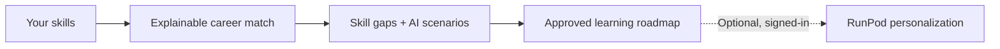

<div align="center">

# 🌐 SkillShift AI

**Understand your skills. Explore future careers. Learn what comes next.**

An explainable, Malaysia-focused career-readiness and reskilling platform built for the **SDC Hackathon — Domain 1: Aiversecity Future-Ready Workforce**.

**SDG 4: Quality Education** · React + TypeScript · FastAPI · Supabase · RunPod

</div>

## The problem

AI is changing how people work, but students and fresh graduates often don't know **which skills they need, how ready they are for a career, or where to start learning**. Generic career advice can be difficult to verify or put into action.

**SkillShift AI turns a skills profile into an explainable career match and a practical learning roadmap**, with Malaysian workforce evidence where available.

## What SkillShift AI does

| Feature | What users get |
| --- | --- |
| **Skills profile** | Select existing skills, interests and a target career. |
| **Career matching** | Explore nine curated careers, readiness scores and missing skills. |
| **Future scenarios** | Compare *moderate* and *rapid* AI-adoption assumptions—not guaranteed forecasts. |
| **Workforce evidence** | View attributed career and skills context from curated sources, including DOSM, O*NET and OECD where applicable. |
| **Instant learning roadmap** | Get relevant options from **39 curated, approved learning resources**, with estimated study times where available. |
| **Optional AI personalization** | Signed-in users can ask RunPod to reorder/select **approved courses only**. The instant roadmap stays usable if AI is slow or unavailable. |

### How it works



**What makes it different:** Career readiness is calculated by a transparent, deterministic scoring engine—not invented by an LLM. AI can assist with the learning plan, but course IDs are checked against the approved catalog before results appear.

## Try the demo

1. Open the app and choose your existing skills.
2. **Analyze** your profile to see matching careers and skill gaps.
3. Compare the **moderate** and **rapid** scenarios.
4. Select a target career and generate an **approved-course roadmap** instantly.
5. Optionally sign in and choose **Personalize with AI**. If RunPod is cold-starting or times out, your original roadmap remains available.

> **Live demo URL:** Add the verified public deployment link here when published. The app can also be run locally using the steps below.

## Tech stack

| Layer | Technologies |
| --- | --- |
| Frontend | React 19, TypeScript, Vite, Tailwind CSS, Recharts |
| Backend | Python, FastAPI, Pydantic |
| Authentication | Supabase Auth |
| Optional AI | RunPod-hosted language model, server-side validation and usage quotas |
| Data | Curated career/skill/course catalogs; attributed Malaysian and international evidence |
| Deployment | Replit target; FastAPI serves the built React app |

## Run locally

**Prerequisites:** Python 3.12, Node.js 22 and npm.

**1. Backend — terminal 1 (PowerShell)**

```powershell
python -m venv .venv
.\.venv\Scripts\python.exe -m pip install -r requirements.txt
Copy-Item .env.example .env
.\.venv\Scripts\python.exe -m uvicorn backend.main:app --reload --port 8000
```

**2. Frontend — terminal 2**

```powershell
cd frontend
npm ci
npm run dev
```

Open **http://localhost:5173**. The standard career analysis and approved-course roadmap do **not** require RunPod. For Supabase sign-in, configure the public frontend variables documented in [`frontend/.env.example`](frontend/.env.example). For optional AI, configure backend-only RunPod credentials and `AI_ENABLED=true` using [`.env.example`](.env.example). Never commit `.env` or keys.

**Tests:** `python -m pytest -q` · `cd frontend && npm run build`

## Reliability and responsible AI

- **Grounded recommendations:** Only approved catalog courses may appear in roadmaps; some skill gaps may remain uncovered.
- **Transparent evidence:** Career-level market observations are not automatically skill demand measurements, and not every career has the same level of available evidence.
- **Honest uncertainty:** AI-adoption scenarios are hypothetical; readiness is a weighted skill match, **not** a hiring probability.
- **Cost-aware AI:** Personalization requires a verified session and is subject to quotas. RunPod can cold-start; the standard roadmap works independently.
- **Privacy and security:** API validation, request limits and server-side credentials are included. A hackathon prototype is **not** a certified security or employment assessment.

## Team

| Member | Responsibility |
| --- | --- |
| **1** | Frontend, interaction design and user experience |
| **2** | FastAPI, career matching, integration, security and deployment |
| **3** | RunPod inference and AI-assisted learning roadmap |
| **4** | Malaysian workforce evidence, career/skill catalog and approved courses |

## More detail

- [System architecture](docs/architecture.md) · [Backend](docs/backend.md) · [Frontend](docs/frontend.md)
- [AI integration](docs/ai_integration.md) · [Data sources](docs/data_sources.md)
- [Security and deployment notes](docs/SECURITY_HARDENING_2026.md) · [AI/tools declaration](docs/ai_tools_declaration.md)

<div align="center">

**SkillShift AI** · **SDG 4 — Quality Education** · *Learning pathways, not employment guarantees.*

</div>
